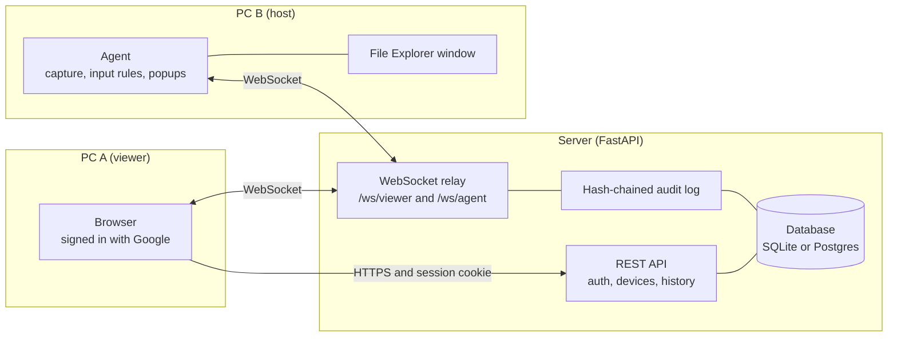
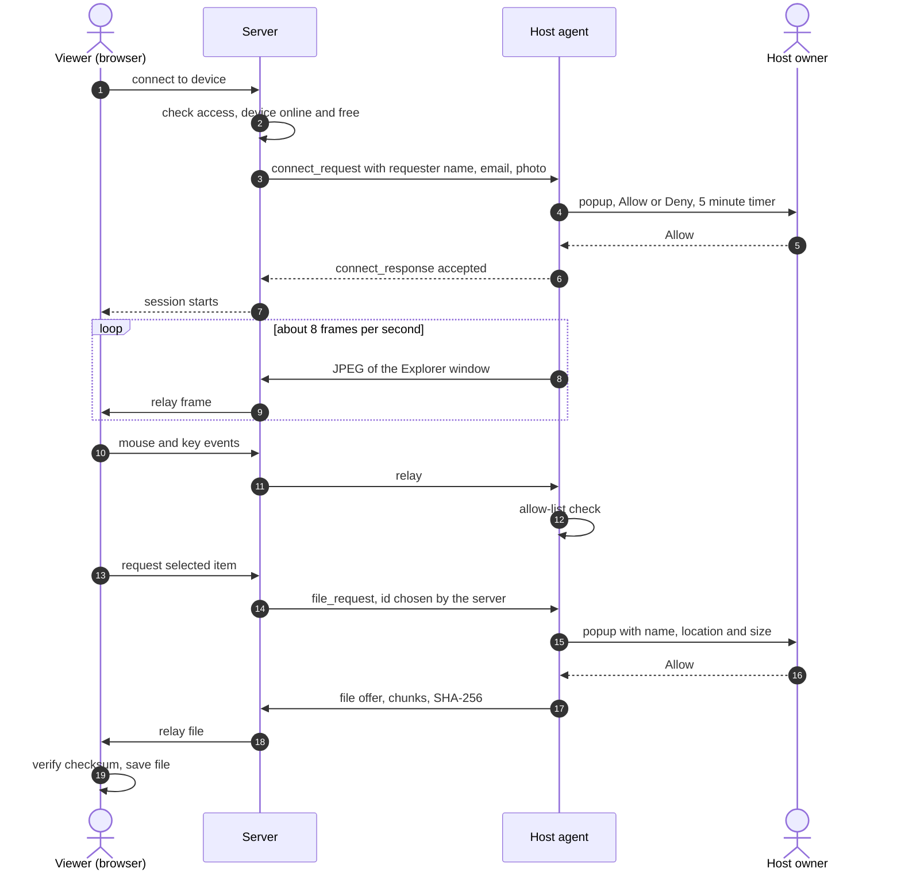
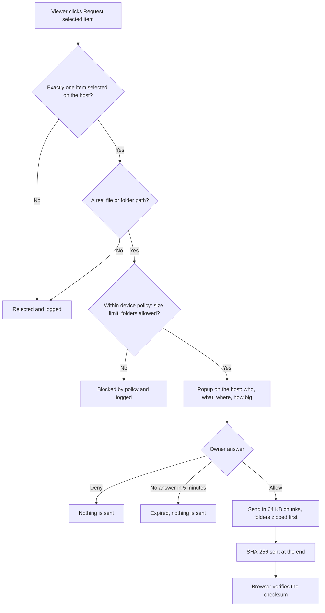
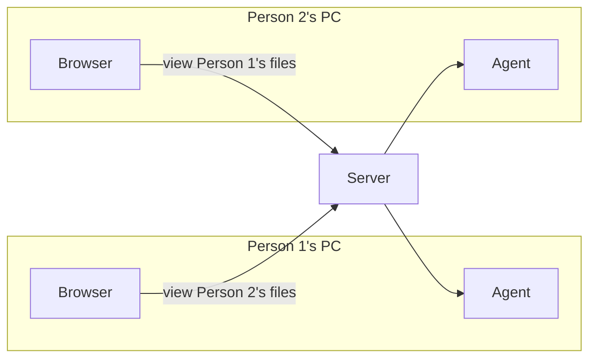
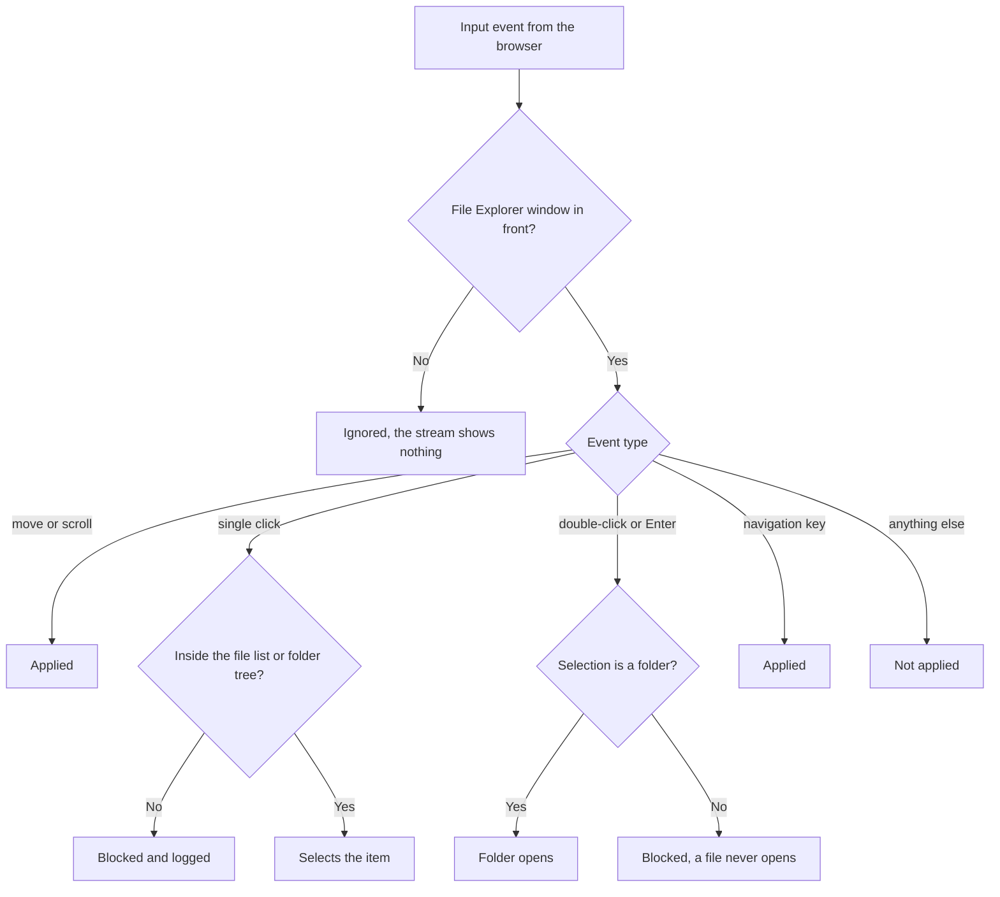
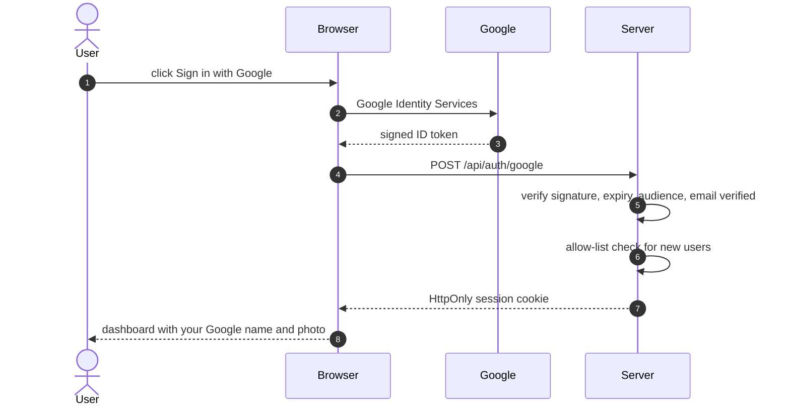
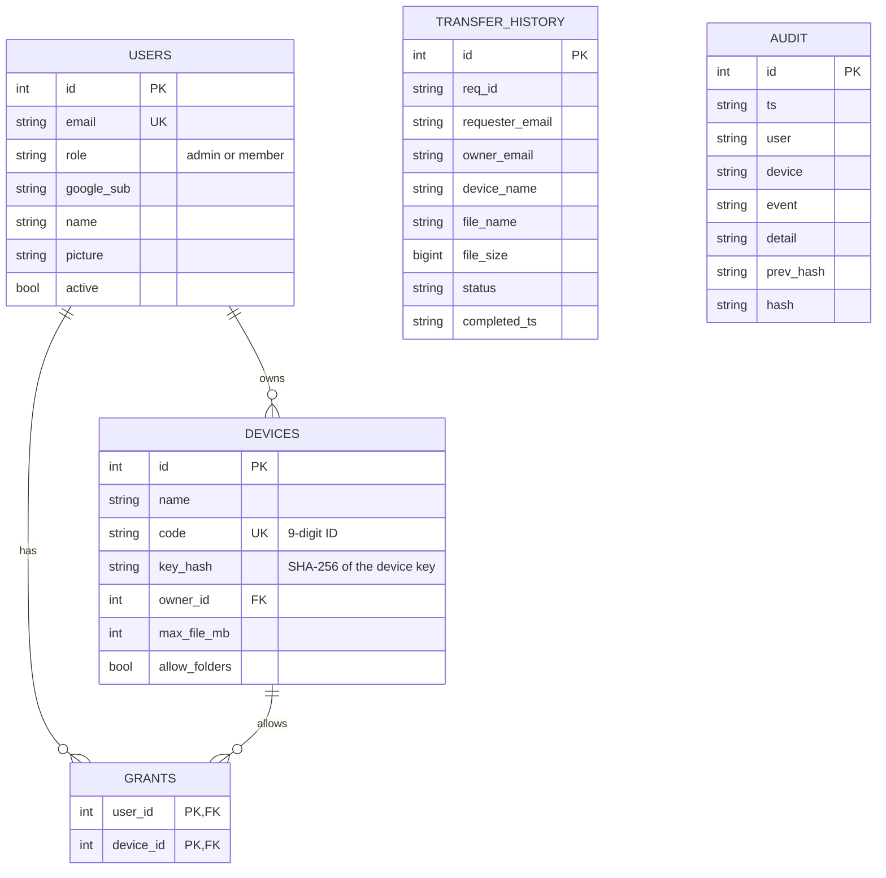
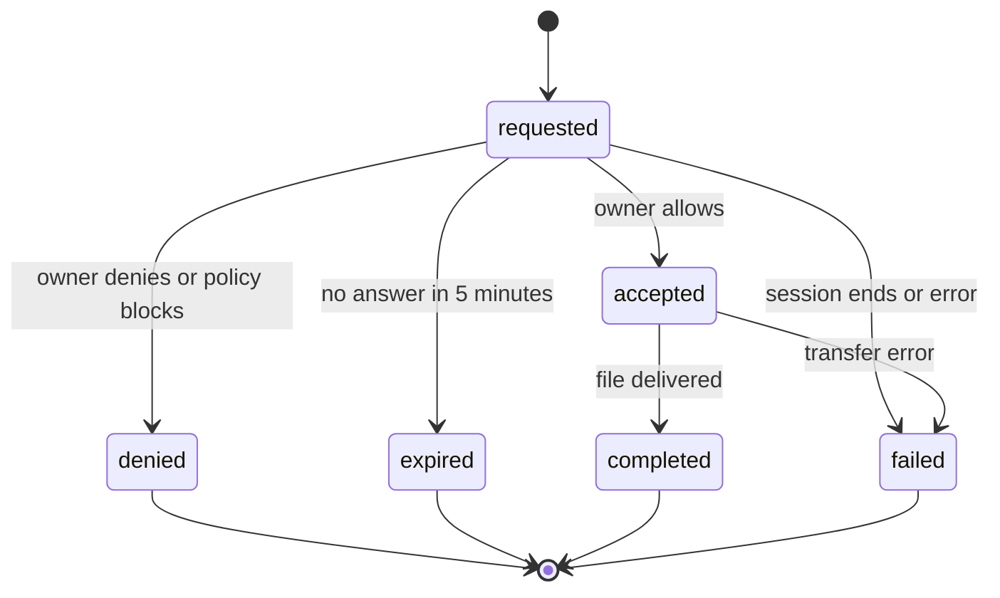
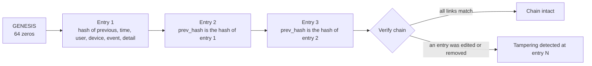
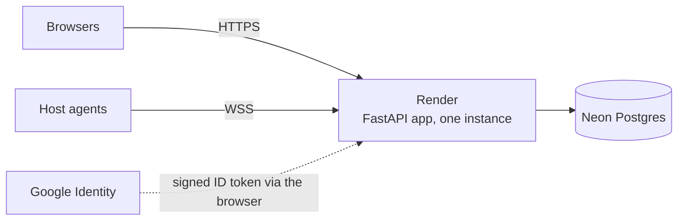

<p align="center">
  
</p>

<h3 align="center">Browse a teammate's File Explorer. They approve every file.</h3>

<p align="center">
  
  
  
  
  
  
</p>

---

## Contents

[Overview](#overview) | [How it works](#how-it-works) | [Browse but never open](#browse-but-never-open) | [Sign-in](#sign-in) | [Data model](#data-model-and-audit-trail) | [Quick start](#quick-start) | [Configuration](#configuration) | [Deploy](#deploy-free-render--neon) | [Security](#security-model) | [Roadmap](#roadmap)

---

## Overview

**Mini Remote** lets one person look through another person's files without taking over their computer.

A viewer asks to connect. The host owner sees **who is asking** (Google name, email and photo) and accepts or denies. If they accept, the viewer sees **only the host's File Explorer window**, can click through folders, but **cannot open a file**. To get a file, the viewer selects it and requests it, and the owner gets a second popup **for that one item**. Every step is written to a tamper-evident audit log.

The architecture borrows its idea from [RustDesk](https://github.com/rustdesk/rustdesk): two peers never connect directly, they both connect to a rendezvous server that relays messages. Mini Remote rebuilds that idea small, in Python and a browser, and adds a consent model on top.

### Why it is different

| | General-purpose remote desktop | Mini Remote |
|---|---|---|
| What the viewer sees | The whole desktop | Only the File Explorer window |
| What the viewer can do | Full mouse and keyboard | Hover, scroll, select, open folders |
| File access | Anything the session can reach | One item at a time, approved by the owner |
| Who enforces the rules | Often the viewer app | **The host agent**, so a modified browser cannot bypass them |
| Record of what happened | Server logs you must trust | Hash-chained audit log with a Verify button |

> **Design rule: the host decides, and the host enforces.** The server relays, the browser asks, and the agent on the host is the only thing that can say yes.

### Feature highlights

| Area | What you get |
|---|---|
| Sign-in | Google sign-in for anyone you allow, optional dev password login |
| Devices | Add your own PC in one click, share a 9-digit ID, add a friend's PC by typing their ID |
| Consent | Popup with requester name, email and photo, **Deny is the default**, no answer for 5 minutes means denied |
| Files | Per-item approval, folders sent as zip, chunked transfer, SHA-256 checksum verified in the browser |
| Policy | Per-device maximum file size and whether folders may be sent, pushed to the agent live |
| History | Every request with name, path, size and status, filterable, exportable to CSV |
| Audit | Central log of logins, sessions, requests, decisions and blocked actions, with **Verify chain** |

<!--
Screenshots: add four PNG files to docs/screenshots/ and remove the comment markers around this block.

| Devices | Consent popup |
|---|---|
|  |  |
| **Shared Explorer** | **Audit log** |
|  |  |
-->

---

## How it works

### Architecture

Neither PC connects to the other. Both connect to the server, which relays messages.



Three channels share the relay, and each has its own approval rule:

| Channel | Direction | Carries | Needs the owner's approval |
|---|---|---|---|
| Screen (binary `0x01`) | host to viewer | JPEG frames of the Explorer window only | Once, when connecting |
| Input (JSON) | viewer to host | Mouse and key events | Only after the owner accepts, then filtered by the agent |
| File (binary `0x02` plus JSON) | host to viewer | Chunked transfer with a SHA-256 checksum | **Every single item** |

### A full session



### What happens when a file is requested



The requested path is **read from the selection in the shared window**. The viewer never types a path, so it cannot ask for something it cannot see.

### Both PCs can share with each other

Run the agent and sign in on both PCs. The same flow works in either direction, so files can move both ways with the same approvals.



---

## Browse but never open

All input rules run in the **agent on the host**, so a modified browser page gets nowhere.



| Allowed | Blocked |
|---|---|
| Hover and scroll | Right-click, drag |
| Left single-click inside the file list or folder tree | Clicks on the ribbon, toolbar or address bar |
| Arrow keys, Home, End, Page Up, Page Down, Backspace | Typing and shortcuts, Delete, rename |
| Opening a **folder** (checked through the Windows Shell COM API) | Opening a **file** |

Clicks are also rate-limited so two quick clicks can never become an operating-system double-click on a file.

---

## Sign-in



- Your Google **name and photo** are shown in the dashboard and in the host's consent popup, along with your verified email.
- The requester identity is built **on the server** from the signed-in account, never from anything the browser sends.
- Display names are cleaned of control and right-to-left characters so nobody can disguise who is asking.

---

## Data model and audit trail



### Transfer lifecycle

A finished request never changes again, and requests left open when the server stops are marked `failed` on the next start.



### Tamper-evident audit log

Each entry stores the hash of the one before it. Editing or deleting any row breaks every link after it, and **Verify chain** shows where.



---

## Tech stack

| Layer | Technology |
|---|---|
| Server | Python, FastAPI, WebSockets, SQLAlchemy |
| Database | SQLite locally, Postgres (Neon) when hosted |
| Web page | Plain HTML and JavaScript with a `<canvas>` viewer, no build step |
| Agent | Python: `mss` and Pillow (capture), `pyautogui` (input), `pywin32` (Explorer and Shell COM), `tkinter` (popups), `websockets` |
| Auth | Google Identity Services, scrypt for the optional password login |
| Hosting | Render (app) and Neon (Postgres), both free tiers |

How it maps to RustDesk:

| RustDesk | Mini Remote |
|---|---|
| `hbbs` and `hbbr` (rendezvous and relay) | FastAPI server that matches users to devices and relays messages |
| `libs/scrap` (screen capture) | `mss` with JPEG encoding |
| `libs/enigo` (mouse and keyboard) | `pyautogui`, behind an allow-list |
| File transfer | Chunked transfer over WebSocket with a checksum |
| Flutter UI | HTML and JavaScript viewer |

---

## Quick start

You need Python 3.12 and Windows on the **host** (the agent drives File Explorer). The server runs anywhere.

### 1. Get the code

```powershell
git clone https://github.com/siveshraajd-stack/mini-remote.git
cd mini-remote
```

### 2. Create a Google sign-in client

1. In [Google Cloud Console](https://console.cloud.google.com/) open **APIs & Services > Credentials > Create credentials > OAuth client ID > Web application**.
2. Under **Authorized JavaScript origins** add `http://localhost:8000` (and your Render address later).
3. Set the consent screen to **External** and publish it, otherwise only listed test users can sign in.
4. Copy the client ID. The client secret is not used by this app.

### 3. Run the server

```powershell
cd server
pip install -r requirements.txt
copy .env.example .env      # then edit .env
uvicorn main:app --host 0.0.0.0 --port 8000
```

Open `http://localhost:8000` and sign in with the Google account you set as `ADMIN_EMAIL`. That account becomes the admin.

### 4. Add a PC and start its agent

1. On the PC you want to share, sign in and press **Add my PC**.
2. Copy the **device key** (shown once) and note your **9-digit ID**.
3. On that PC:

```powershell
cd agent
pip install -r requirements.txt
python agent.py http://<server-address>:8000
```

Paste the device key when asked. The address and key are remembered in `%APPDATA%\MiniRemote\config.json`.

### 5. Connect

1. The person who wants to look types your ID under **Connect to a friend's PC** and presses **Add by ID**.
2. Your PC appears in their list with a green dot. They press **Connect**.
3. You see a popup with their name, email and photo, and press **Allow**.
4. They browse folders, select a file and press **Request selected item**.
5. You approve that file, and it downloads with a verified checksum.

> **Different networks?** A local address only works on the same Wi-Fi. For a quick demo use a tunnel (`cloudflared tunnel --url http://localhost:8000`), or host the server on Render. Google sign-in only works on `localhost` or an `https://` address.

### Three-minute demo

1. Sign in with Google. The dashboard shows your name and photo.
2. Connect to a device. The host's popup names the requester. Allow it.
3. Browse folders, then double-click a file and show that it does not open.
4. Request a file. **Deny** it and show that nothing is sent.
5. Request it again and **Allow** it. The file downloads with a verified checksum.
6. Open **Admin > Audit log**, filter by the device, press **Verify chain** and export the CSV.

---

## Configuration

Set these in `server/.env` locally or in the host's environment settings. A template is in [`server/.env.example`](server/.env.example).

| Variable | Purpose |
|---|---|
| `GOOGLE_CLIENT_ID` | OAuth client ID used to verify Google sign-in |
| `ADMIN_EMAIL` | Account that becomes admin and is always allowed in |
| `SECRET_KEY` | Long random text for signing session cookies. Required when hosting |
| `ALLOW_ANY_GOOGLE` | Set to `1` to let any Google account sign in |
| `ALLOWED_DOMAIN` | Only allow sign-in from this email domain |
| `ALLOWED_EMAILS` | Only allow these emails (comma separated) |
| `DISABLE_PASSWORD_LOGIN` | Set to `1` to turn off the dev password login |
| `ADMIN_PASSWORD` | Dev-login password for the first admin (local use only) |
| `DATABASE_URL` | Postgres connection string. Unset means local SQLite |

With none of the three allow settings, **only `ADMIN_EMAIL` can sign in**, so opening sign-up is a deliberate choice. New users start as members with no access to anything until another person shares an ID with them and approves their requests.

---

## Deploy (free: Render + Neon)

1. **Neon**: create a free project and copy the connection string. Render's free disk is wiped on restart, so the data must live in Postgres.
2. Push this repo to GitHub.
3. **Render**: **New > Blueprint**, pick the repo (it reads `render.yaml`).
4. In Render's environment settings set `DATABASE_URL`, `SECRET_KEY`, `ADMIN_EMAIL`, `GOOGLE_CLIENT_ID` and your sign-in setting (`ALLOW_ANY_GOOGLE=1`, `ALLOWED_DOMAIN` or `ALLOWED_EMAILS`).
5. Add your Render address under **Authorized JavaScript origins** in Google Cloud Console.
6. Run exactly **one** instance. The relay keeps live sockets in memory.



Free tiers sleep when idle and their limits change, so check the current terms. The agent sends a heartbeat every 25 seconds, which keeps the service awake while a device is online.

### Package the agent as an .exe

```powershell
cd agent
build-agent.bat
```

This builds `MiniRemoteAgent.exe` with PyInstaller.

---

## Project structure

```
mini-remote/
├── README.md
├── render.yaml                 Render blueprint
├── docs/
│   └── banner.svg
├── server/
│   ├── main.py                 API, WebSocket relay, accounts, history, audit
│   ├── requirements.txt
│   ├── .env.example
│   └── static/
│       └── index.html          sign-in, devices, viewer, history, admin
└── agent/
    ├── agent.py                capture, input rules, popups, file transfer
    ├── requirements.txt
    └── build-agent.bat         builds the exe with PyInstaller
```

---

## Security model

| Risk | How it is handled |
|---|---|
| Viewer tries to open a file | The agent allows double-click and Enter only when the selection is a folder |
| Viewer tries to guess or type a path | The path is read from the selection in the shared window, never typed |
| Spoofed requester name | Identity is built on the server from the verified Google account, and the email is always shown |
| Look-alike names (right-to-left or invisible characters) | Display names are cleaned before use |
| Guessing device IDs | Rate-limited per user, with a lockout window |
| Leaked device key | Keys are stored hashed, shown once, and can be replaced or the device removed |
| Tampered logs | Hash chain plus **Verify chain** |
| Cross-site WebSocket hijacking | The viewer socket checks the request origin |
| Password guessing | scrypt hashing and a lockout after repeated failures, and password login can be switched off |
| Request nobody answers | Deny is the default button, and no answer for 5 minutes means denied |
| Request ID tampering | The server picks the request ID and ignores the browser's |

Host-side settings that matter:

- Turn the **Preview pane off** and use **Details** view, because thumbnails and previews show file contents.
- Keep Explorer's default **double-click to open** setting. Single-click-to-open would defeat the file-opening block.
- Use only on computers you own or are authorised to manage.

## Known limits

- About 8 to 10 frames per second: enough for browsing, not for video.
- The agent is Windows-only, and the Windows key and Ctrl+Alt+Del cannot be sent from a browser.
- The host's mouse cursor is not drawn in the stream.
- Traffic is encrypted to the server over HTTPS, but the server relays it. There is no end-to-end encryption yet.
- Session cookies are stateless, so signing out removes the cookie in your browser but does not revoke a copied one before it expires.
- There is no change-password page yet.

## Roadmap

- [x] Google sign-in with name and photo in the dashboard and consent popups
- [x] Add your own PC, share a 9-digit ID, add a friend's PC by ID
- [x] Per-item file approval with a 5-minute expiry
- [x] Transfer history with CSV export
- [x] Remove device (owner or admin)
- [x] Hash-chained audit log with Verify chain
- [ ] One-click role switch between sender and receiver
- [ ] Change-password page and revocable sessions
- [ ] Live End session button and a tray icon for the agent
- [ ] Start the agent automatically with Windows
- [ ] Email or webhook alerts for failed logins and blocked actions
- [ ] Block list so an owner can stop a user from sending requests
- [ ] End-to-end encryption between agent and viewer

## Troubleshooting

| Problem | Cause | Fix |
|---|---|---|
| "Google sign-in is not set up on this server" | `GOOGLE_CLIENT_ID` is missing, or `.env` was saved with a hidden byte-order mark | Check the variable name, and save `.env` as plain UTF-8 |
| Google button shows an origin error | The address is not in Authorized JavaScript origins | Add the exact address, and use `localhost` or `https://` |
| `Errno 10048` on port 8000 | An old server is still running | Press Ctrl+C in the old window, or find it with `netstat -ano \| findstr :8000` and `taskkill` |
| Page unreachable from the other PC | Different network or firewall | Same Wi-Fi, a hotspot, an inbound firewall rule for port 8000, or a tunnel |
| Viewer sees "restricted" | No File Explorer window is in front on the host | Bring an Explorer window to the foreground on the host |
| Clicks land in the wrong place | Stale page | Hard-refresh with Ctrl+F5 |
| Old behaviour after an update | An old server or agent is still running | Stop it, and restart from the updated folder |

## Acknowledgements

The relay-between-two-peers architecture is inspired by [RustDesk](https://github.com/rustdesk/rustdesk), which is licensed AGPL-3.0. Mini Remote copies the design idea only, not the code.

## Author

**Sivesh** · [GitHub](https://github.com/siveshraajd-stack) · [LinkedIn](https://linkedin.com/in/sivesh-raaj-d-b0b80934a)
